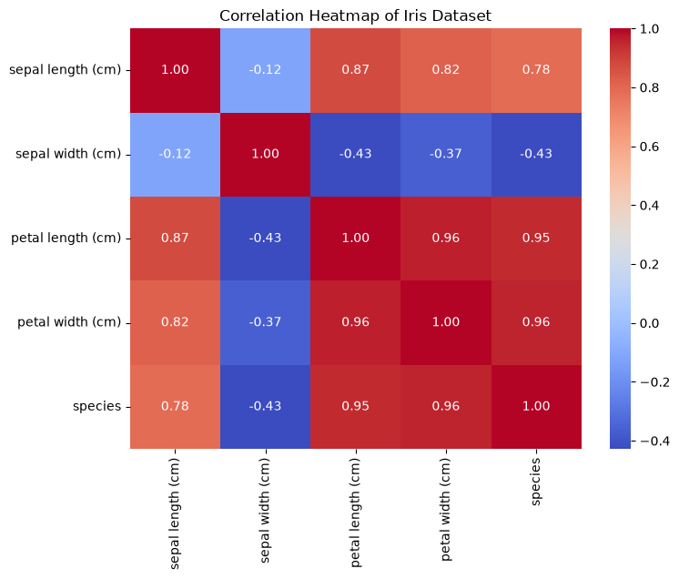
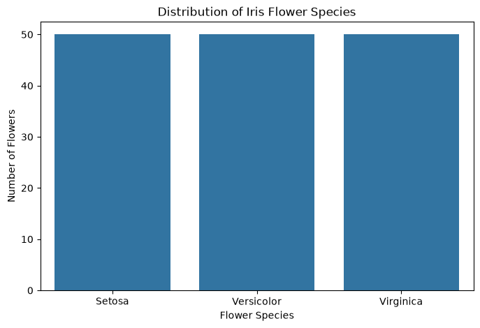
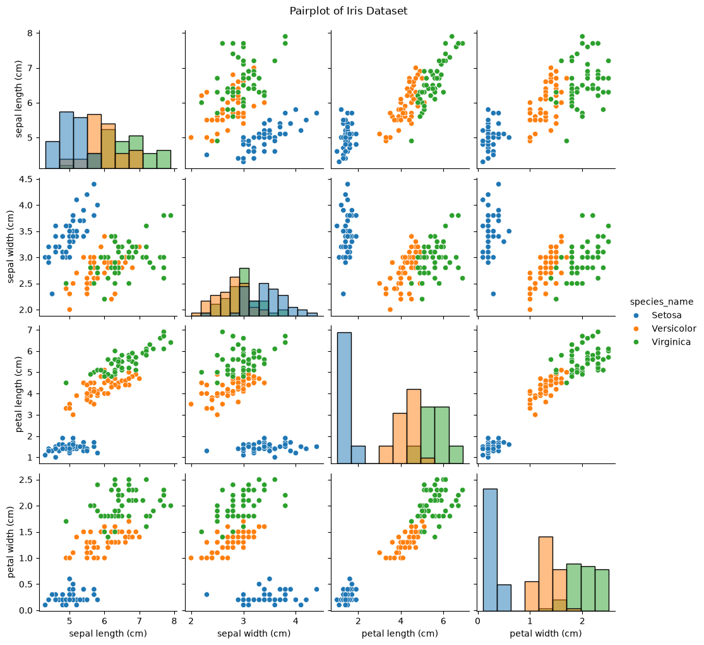
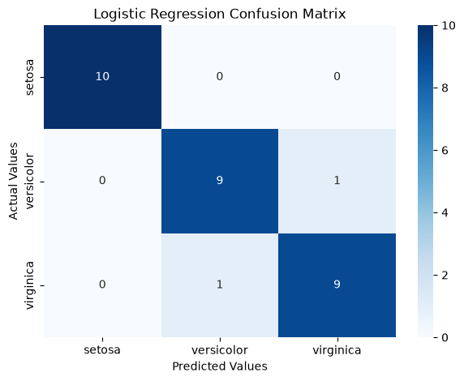
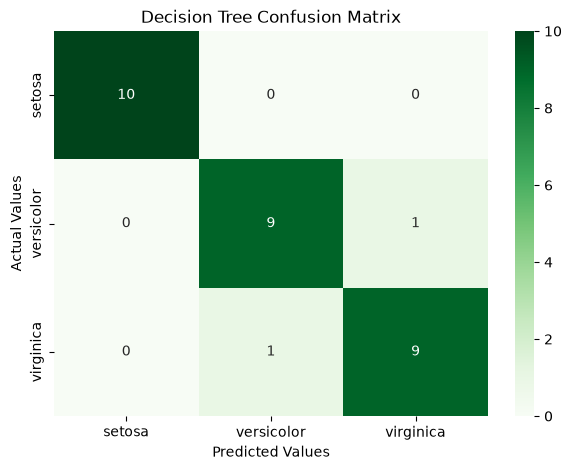
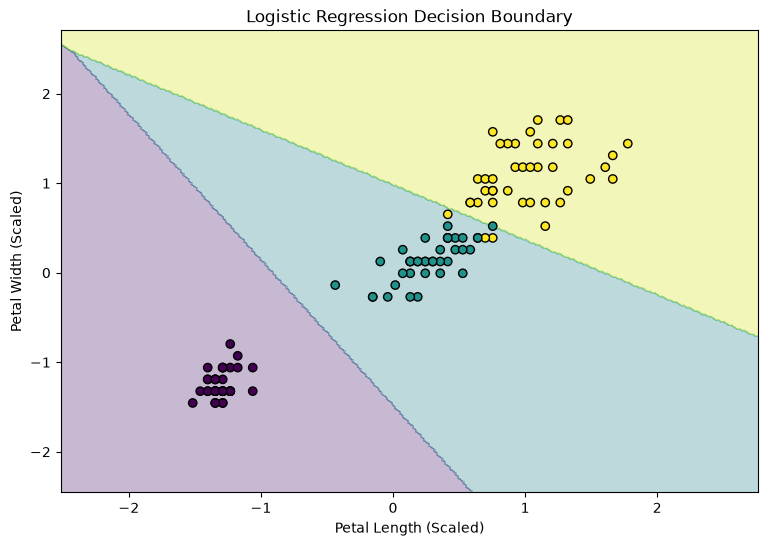
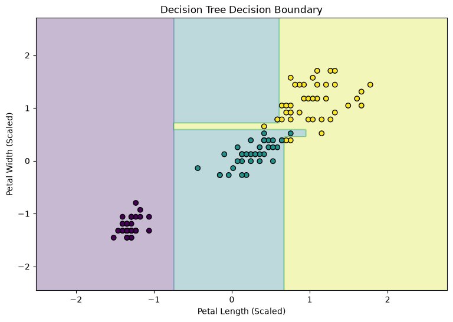

# 🌸 Iris Flower Classification | Machine Learning Project

<p align="center">
  <strong>Datheon – Machine Learning and Data Science Internship</strong>
</p>

<p align="center">
  
  
  
  
</p>

---

## 📌 1. Project Overview

This project is part of the **Datheon Machine Learning and Data Science Internship – Task 1: Classification**.

The main objective is to build and evaluate machine learning classification models to predict the species of Iris flowers based on their physical measurements.

Two machine learning algorithms are implemented:

- Logistic Regression
- Decision Tree Classifier

The project covers the complete machine learning workflow, from dataset exploration and preprocessing to model training, evaluation and visualization.

## 🎯 2. Project Objectives

- Understand and explore the Iris dataset.
- Perform data cleaning and preprocessing.
- Conduct Exploratory Data Analysis (EDA).
- Visualize feature relationships and correlations.
- Split data into training and testing sets.
- Apply feature scaling.
- Build classification models.
- Evaluate model performance.
- Compare classification algorithms.

## 📊 3. Dataset Information

**Dataset:** Iris Dataset (Scikit-learn)

The Iris dataset contains 150 observations belonging to three different flower species.

| Information | Description |
|---|---|
| Total samples | 150 |
| Input features | 4 |
| Target classes | 3 |
| Problem type | Multiclass Classification |
| Data source | Scikit-learn |

### Features

| Feature | Description |
|---|---|
| Sepal Length | Length of the sepal in cm |
| Sepal Width | Width of the sepal in cm |
| Petal Length | Length of the petal in cm |
| Petal Width | Width of the petal in cm |

### Target Classes

- Iris Setosa
- Iris Versicolor
- Iris Virginica

## 🛠️ 4. Technologies and Libraries

| Technology | Purpose |
|---|---|
| Python | Programming language |
| Pandas | Data manipulation |
| NumPy | Numerical operations |
| Matplotlib | Data visualization |
| Seaborn | Statistical visualization |
| Scikit-learn | Machine learning |
| Jupyter Notebook | Development environment |

## 🔄 5. Project Workflow

1. Import required libraries.
2. Load the Iris dataset.
3. Explore dataset structure and information.
4. Check missing values.
5. Perform statistical analysis.
6. Conduct Exploratory Data Analysis.
7. Generate data visualizations.
8. Split data into training and testing sets.
9. Apply feature scaling.
10. Train Logistic Regression.
11. Train Decision Tree Classifier.
12. Evaluate and compare both models.

---

## 📈 6. Exploratory Data Analysis (EDA)

### 6.1 Correlation Heatmap

The correlation heatmap helps understand relationships between numerical features.



### 6.2 Species Distribution

Visualizes the distribution of the three Iris flower species.



### 6.3 Pairplot

Displays relationships between different features and helps identify patterns among flower species.



---

## 🤖 7. Machine Learning Models

### 7.1 Logistic Regression

Logistic Regression is a supervised classification algorithm used to predict the probability of a sample belonging to a particular class.

### 7.2 Decision Tree Classifier

Decision Tree is a supervised machine learning algorithm that uses decision rules to classify observations into different categories.

---

## 📊 8. Model Evaluation

Both classification models are evaluated using the testing dataset.

### 8.1 Performance Comparison

| Model | Accuracy |
|---|---:|
| Logistic Regression | 93.33% |
| Decision Tree Classifier | 93.33% |

### 8.2 Logistic Regression – Confusion Matrix

The confusion matrix visualizes the correct and incorrect predictions made by the Logistic Regression model.



### 8.3 Decision Tree – Confusion Matrix

The confusion matrix evaluates the classification performance of the Decision Tree model.



---

## 📉 9. Decision Boundary Visualization

Decision boundaries illustrate how classification models separate different Iris flower classes using selected features.

### 9.1 Logistic Regression



### 9.2 Decision Tree Classifier



---

## 🏆 10. Conclusion

This project successfully demonstrates the implementation of a multiclass classification workflow using the Iris dataset.

Two machine learning algorithms, Logistic Regression and Decision Tree Classifier, were trained and evaluated.

Both models achieved **93.33% accuracy** on the test dataset.

The project provided practical experience in:

- Data exploration and preprocessing.
- Exploratory Data Analysis.
- Data visualization.
- Supervised machine learning.
- Model evaluation and comparison.

## 📁 11. Repository Structure

Task_1_Classification/
│
├── Dataset/
│
├── Images/
│   ├── correlation_heatmap.png
│   ├── species_distribution.png
│   ├── pairplot.png
│   ├── logistic_regression_confusion_matrix.png
│   ├── decision_tree_confusion_matrix.png
│   ├── logistic_regression_boundary.png
│   └── decision_tree_boundary.png
│
├── notebook/
│   └── classification_pipeline.ipynb
│
├── requirements.txt
└── README.md


## ▶️ 12. How to Run This Project

**Step 1:** Clone the repository.

```bash
git clone https://github.com/prasanth491999-prog/Datheon_Machine_Learning_and_Data_Science_Internship.git
```

**Step 2:** Navigate to the project folder.

```bash
cd Datheon_Machine_Learning_and_Data_Science_Internship/Task_1_Classification
```

**Step 3:** Install the dependencies.

```bash
pip install -r requirements.txt
```

**Step 4:** Launch Jupyter Notebook.

```bash
jupyter notebook
```
**Step 5:** Open [View Classification Pipeline](notebook/classification_pipeline.ipynb)
---

## 👨‍💻 Internship Details

| Detail | Information |
|---|---|
| Organization | Datheon |
| Program | Machine Learning and Data Science Internship |
| Task Number | Task 1 |
| Project | Iris Flower Classification |
| Domain | Machine Learning |

---

<p align="center">
  <strong>🌸 End of Task 1 – Iris Flower Classification</strong>
</p>

<p align="center">
  Built with Python and Machine Learning.
</p>
## 📓 Jupyter Notebook

[View Classification Pipeline](notebook/classification_pipeline.ipynb)
